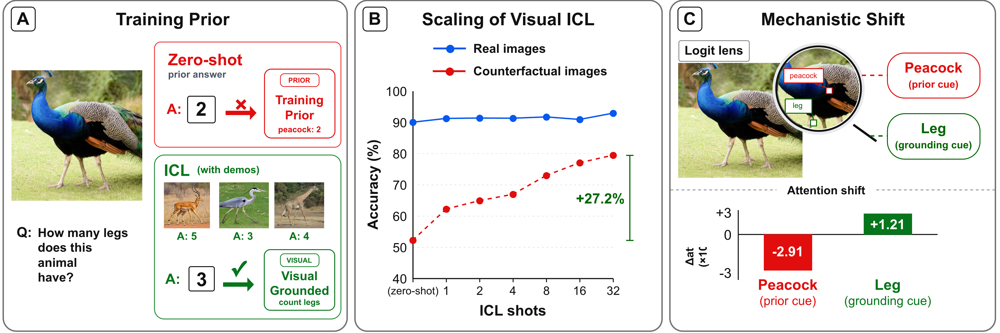
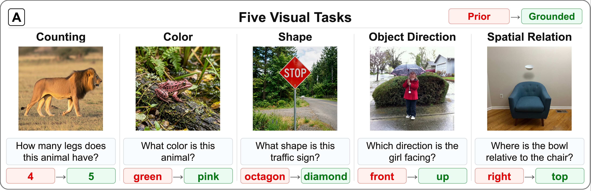

<div align="center">

# In-Context Learning Can Help Vision-Language Models Overcome Training Priors

Kun Wang, Xindi Wu, Sanghyuk Chun, Olga Russakovsky, Esin Tureci

[](https://arxiv.org/abs/2610.12942)
[](https://arxiv.org/abs/2610.12942)
[](https://huggingface.co/datasets/kunwang0129/visual-reasoning)
[](LICENSE)

</div>

> [!NOTE]
> This repository is the official code for our **NeurIPS 2026** paper,
> [*In-Context Learning Can Help Vision-Language Models Overcome Training Priors*](https://arxiv.org/abs/2610.12942).

<p align="center">
  
</p>

Vision-language models often answer from statistical priors learned in training rather than
from the image: asked how many legs a peacock has, they answer 2 even when the image shows 3.
We use controlled visual in-context learning to separate missing visual ability from
over-reliance on priors. Across five vision-centric tasks, demonstrations raise accuracy on
prior-conflicting counterfactual images by up to 27.2 points (Qwen3-VL 235B) while leaving
prior-aligned images almost unchanged, with similar gains across five VLM families. Attention
and LatentLens analyses show the demonstrations shift the model's focus from prior cues to
grounding cues. ICL helps little when the underlying visual capability is weak or missing.

## Benchmark

<p align="center">
  
</p>

`visual_reasoning` pairs each question with images whose grounded answer conflicts with the
prior answer, over five tasks: counting, color, shape, object direction and spatial relation.
It is released on the Hugging Face Hub together with its stress-test, lens and control
variants; experiments also run on [BLINK](https://huggingface.co/datasets/BLINK-Benchmark/BLINK).
See [doc/DATA.md](doc/DATA.md).

Supported models: Qwen3-VL, Qwen3.5, Qwen2.5-VL, InternVL 3.5 and Gemma 4 (Hugging Face
Transformers or vLLM), and Gemini and GPT through their APIs.

## Quick start

```bash
git clone https://github.com/princetonvisualai/vlm_icl_tp && cd vlm_icl_tp
bash env_setup.sh eval            # builds .venv-eval (vLLM, API clients)
source login_setup.sh eval        # selects it for `uv run`

uv run python -m experiments.icl_scale --model_path /path/to/Qwen3-VL-8B-Instruct \
    --backend vllm --tasks counting --shot_counts 0 2 8 --n_per_label 20 --seed 42
```

The data is downloaded from the Hub on first use unless it is already under `data/`. Results go
to `output/`. `env_setup.sh` and `login_setup.sh` assume a module-based SLURM cluster; the plain
`uv` commands are in [doc/SETUP.md](doc/SETUP.md).

## Documentation

| Guide | Contents |
|---|---|
| [Setup](doc/SETUP.md) | environments, API keys, model checkpoints, tests |
| [Data](doc/DATA.md) | datasets, Hub mirrors, file layout, loading |
| [Experiments](doc/EXPERIMENTS.md) | paper experiments, SLURM launcher, model table |
| [Reproducing the paper](doc/REPRODUCE.md) | figures and tables, experiment by experiment |
| [Further analyses](doc/ANALYSES.md) | extra experiments, inference and evaluation, ablation modes |
| [Output layout](doc/OUTPUT.md) | result directories and files |
| [In-context learning](doc/ICL.md) | demo selection, templates, query-GT options |
| [LatentLens](doc/LATENTLENS.md) | LatentLens indices and analyses |

## Repository layout

```
vlm_icl/       library: data, ICL demo selection, prompts, model wrappers, scoring, metrics
experiments/   paper experiments (python -m experiments.<name>); extra/ for further analyses
figures/       paper figures and tables; extra/ for the further analyses
data_hf/       BLINK conversion and Hub publishing of the datasets
slurm/         job launcher, worker script and model table
tests/         unit tests (no GPU needed)
doc/           guides
```

## Citation

```bibtex
@inproceedings{wang2026icl,
  title     = {In-Context Learning Can Help Vision-Language Models Overcome Training Priors},
  author    = {Wang, Kun and Wu, Xindi and Chun, Sanghyuk and Russakovsky, Olga and Tureci, Esin},
  booktitle = {Advances in Neural Information Processing Systems},
  year      = {2026}
}
```

## License

MIT; see [LICENSE](LICENSE).
